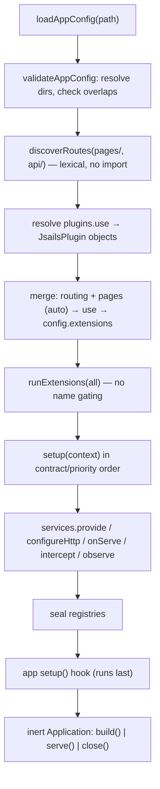
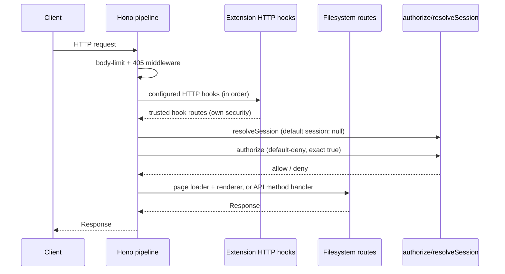
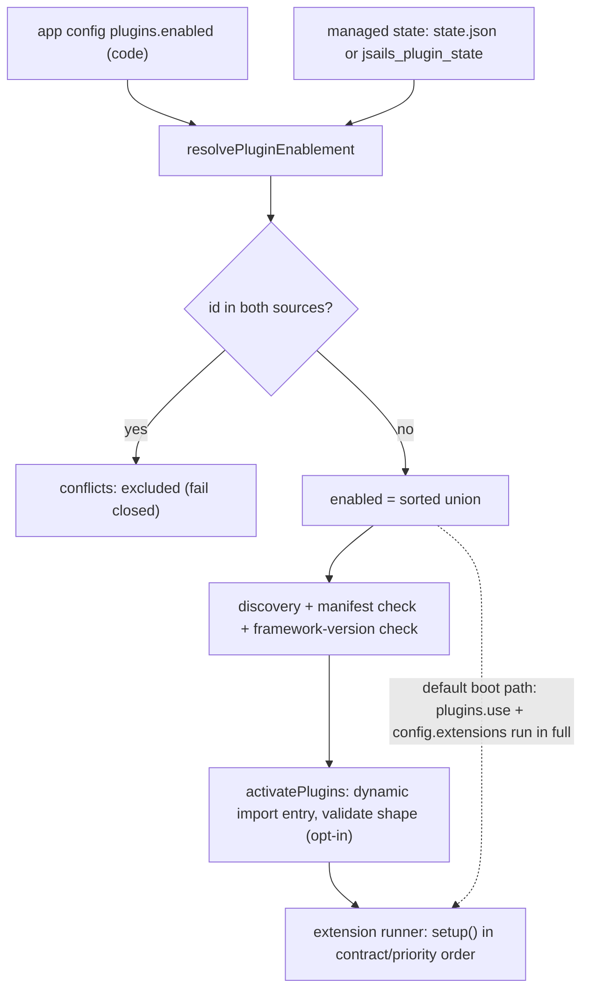
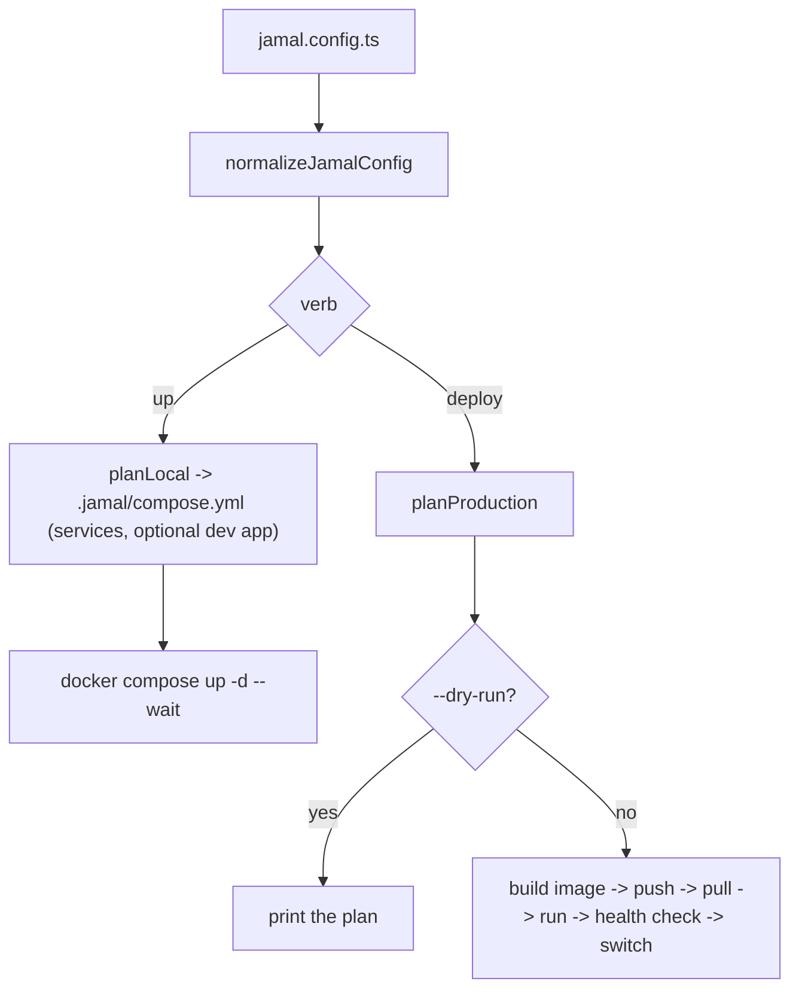

# Architecture

JSails is a TypeScript Active Record data layer plus a bounded application runtime
(extension system, HTTP/pages/API, static export, jobs, broadcast, deploy config,
and a CLI). It deliberately reuses maintained libraries — TypeORM, Zod, BullMQ,
Socket.IO, Preact, Hono — instead of implementing its own renderer, auth stack, or
queue.

Small utilities (duration/byte formatting, deep equality, defaults merging,
concurrency, retry scheduling, base64, error serialization, cookie parsing) are
owned in `src/internal/` rather than added as dependencies. When one big package
already covers the need (for example `es-toolkit` for case and collection
helpers), it is preferred over a collection of small packages; large,
protocol-level, or rule/data-heavy packages stay external.

The framework also dogfoods its own helpers and runtime surfaces: when core needs
a capability it already exposes, it uses that surface rather than a parallel
private helper or a new dependency.

Other frameworks and JavaScript best practices are references, not specifications.
The API is designed for JSails and for the person reading it; there are no
compatibility shims for their own sake.

## Overview and principles

- **Human-first.** The CLI scaffolds, compiles, and serves, but decisions with
  domain impact — applying migrations, destructive schema changes, running a
  production release — remain explicit human actions. `jamal deploy` and
  `jamal rollback` execute by default with `--dry-run` printing the plan.
- **Everything is a plugin.** The kernel is a thin, inert core: config loading, an
  ordered extension runner, route discovery, the Hono pipeline, and the data
  layer. Every capability — auth, admin, blog, jobs, broadcast, cache, mail,
  filesystem, notifications, server components — is a first-party plugin wired
  through the same extension seam.
- **Lazy, inert construction.** Importing a config module or calling a factory
  never opens a connection or reads the environment. Connections are opened only
  by `serve()` (or an extension's own `setup`/first use). This is what keeps
  `jsails build` (static export) working without a database.
- **MariaDB by default, but no lock-in.** Drivers: `mariadb` (recommended),
  `postgres`, `mysql`, and persistent file-backed SQLite via `sqljs`.
- **Bounded, portable schema.** The migration core models a narrow scalar schema
  and rejects anything it cannot faithfully represent.
- **Value-free errors.** Failures that cross a trust boundary never echo raw
  values, credentials, or response bodies.

## Kernel vs plugins

The **kernel** (the `core` package's `src/` substrate: `app/`, `extensions/`,
`routing/`, `pages/`, `server/`, `database/`, `migrations/`, `environment.ts`,
`contracts/`, `jsx/`) provides the runtime and the seams. First-party **plugins**
are separate workspace packages under `packages/*/`, published under the
`@jsails/*` scope (`@jsails/auth`, `@jsails/admin`, `@jsails/blog`,
`@jsails/cache`, `@jsails/live`, `@jsails/theme`, and so on);
they consume the kernel through the same extension seam. Some runtime
capabilities still ship as core modules under `src/` (`jobs/`, `broadcast/`,
`live/`, `signals/`, `server-components/`, `seo/`, `encryption/`), with their
plugin packages re-exporting the contract. The `src/i18n/` translator is a
dependency-free leaf (neither kernel nor plugin — it imports nothing beyond the
platform).

### Kernel contracts

Kernel features expose a typed service token when the application replaces an
implementation. The default implementation stays in core; a plugin or app can
provide its own through the normal service registry.

| Domain | Contract | Token / seam |
| --- | --- | --- |
| Encryption | `Encrypter` (`encrypt`/`decrypt`) | `encryptionToken` + `encryptionPlugin`; model fields resolve the env key source once before extension setup |
| SEO | `SeoService` (`buildHeadTags`/`injectHead`) | `seoToken`; page rendering resolves it per request and falls back to the stateless default |
| i18n | `I18nService` | `i18nToken` + `i18nPlugin` |
| Jobs | `JobsService`, `JobsRuntimeAdapter` | `jobsToken` + `jobsPlugin` |
| Broadcast | `BroadcastAdapter`, `BroadcastService` (`publish`) | `broadcastToken` + `broadcastPlugin`; publishing before serve fails closed |
| Server components | `ServerComponentsRuntime` | `serverComponentsToken` + `serverComponentsPlugin` |
| MCP | `defineMcpTool`, `defineMcpServer` (`@jsails/mcp`) | definitions served over stdio by `serveMcpStdio` (the Streamable HTTP mount arrives with the `mcp` plugin); `jsails mcp` is the developer stdio server in core |

### The extension foundation

An **extension** is a plain object `{ name, requires?, priority?, disabled?, setup(context) }`. `runExtensions` prevalidates every entry, runs `setup` in priority order (lower first, then declaration order), checks each extension's `requires` against services earlier extensions registered, collects HTTP and serve hooks, wires a per-application interceptor/observer registry, seals the registries, and returns a runtime whose `close()` runs cleanups in reverse.

The `setup` context exposes four write surfaces:

- `services.provide(token, value)` / `services.get(token)` — a per-application service registry keyed by opaque `createServiceToken<T>(name)` tokens.
- `configureHttp(hook)` — collect native Hono hooks (after body-limit/405 middleware, before filesystem routes). Hook routes own their own security.
- `onServe(hook)` — run after the HTTP server is created but before it listens.
- `intercept(operation, fn, { phase })` / `observe(event, fn)` — identity-based interception. `before` hooks mutate args, `after` hooks transform the result in reverse order, and observers react to emitted events with errors isolated.

A **plugin** (`definePlugin`) is an extension with a declarative `renderer` passthrough and a `PluginContext` whose `setup` can register interceptors/observers.

### Substrate vs. plugin boundary

The **substrate** is everything upstream of `runExtensions` — the code that must
run before any extension can exist — and it stays in core; everything above that
line is plugin-shaped. [Extending JSails](/docs/extending#substrate-vs-plugin-boundary)
lists the substrate modules and why the introspection commands belong there.

### Application assembly

`loadAppConfig` imports the compiled config module; `validateAppConfig` resolves
directories; `createApplication` discovers routes, resolves declarative
`plugins.use` entries, then runs the merged extensions — the auto-injected
routing and pages plugins, then declarative plugins, then `config.extensions` —
in full, then the app `setup` hook, and returns an inert `Application`.
`plugins.enabled` is a marketplace/managed-only gate for admin-installed plugins,
never a boot-time filter over developer extensions.



## Data layer

`JsailsDataSource` extends TypeORM's `DataSource` and restricts drivers to
`postgres | mysql | mariadb | sqlite` (the `sqlite` logical driver uses `sqljs`
with an atomic write-then-rename `autoSave` callback — single-process, no WAL).
It rejects `synchronize`, `dropSchema`, `migrationsRun`, and a TypeORM
`migrations` config at construction. `getModelSchema()` builds entity metadata
offline.

Entities use `BaseEntity` (Active Record) or `EntitySchema`. The portable schema
model is deliberately bounded: scalar columns (`integer`, `varchar` with explicit
`length`, `text`, `boolean`, `datetime`, `decimal`, `float`, `bigint`, `uuid`,
`json`, `date`, `time`), single or composite primary keys, simple indexes and
unique constraints, single- or multi-column many-to-one foreign keys with
`CASCADE`/`RESTRICT`/`SET NULL`/`NO ACTION`, and many-to-many relations through
explicit junction-table entities or auto-generated `@JoinTable()` junction tables.
Deferrable foreign keys and unique constraints are Postgres-only. Partial or
expression indexes, enums, generated UUIDs, computed columns, and function
defaults are rejected with `UnsupportedSchemaError`.

`FileDataSource` is a read-only, in-memory Active Record source for tests and
demos, backed by `sqljs` in `query_only` mode.

### Transactions and model-level validation

`transaction(dataSource, body)` wraps TypeORM's `manager.transaction` with a
per-call `TransactionHandle` supporting `afterCommit` and `afterRollback`
callbacks. Nested calls for the same data source join the outer transaction;
different data sources open independent transactions.

`defineEntityValidation(entity, schema)` returns an immutable validation
descriptor; `validateEntity` returns a flat `FieldError[]`;
`assertEntityValid` throws `EntityValidationError`.
`entityValidationHooks(validation)` bridges to the subscriber seam, gating
`beforeInsert` and `beforeUpdate`.

### Declarative schema engine

Schema management is declarative, not linear. The model classes (`@jsails.*`) are the
single source of truth — there are no migration files, no JSON artifacts, no applied-state
ledger, and no `migrations/` directory.

`db:push` diffs the declared model schema against the **live** database (TypeORM
`QueryRunner.getTables()`), computes a minimal operation plan, classifies each
operation safe vs destructive, and applies all safe operations automatically. A
destructive operation (drop column/table, narrowing alter, any SQLite alter)
refuses the **entire plan atomically** unless `--allow-destructive` is passed. No
partial apply. `--dry-run` prints the plan without applying it.

`db:diff` is the read-only counterpart — it diffs and prints the same operation
plan but never touches the database.

The only permanent intent marker is `@jsails.renamedFrom('old_name')` on a column or
relation, which tells the differ a rename happened (emits `rename_column` instead of
drop+add). It is idempotent.

Data migrations (`defineDataMigration({ up, down })`) are named functions over a
live `DataMigrationContext` (a TypeORM `QueryRunner`). They are a **second phase**
of `db:push` executed after schema changes succeed, every time `db:push` runs —
including when the schema is already current. Every data migration MUST be
idempotent (guarded `UPDATE ... WHERE <not-yet-migrated>`); a non-idempotent data
migration duplicates rows on each push. `down` is never invoked by a command — it is
a documented manual escape hatch. Data migrations never run if phase 1 refuses or
fails.

Live-only objects are filtered from introspection (no phantom diffs).
MySQL/MariaDB type ambiguity resolves by declared-side tiebreaker; SQLite
introspection is the least faithful. Rollback is manual — there is no ledger to
walk backwards from.

### Polymorphic relations, relation API, through relations

`@PolymorphicRelation` on a child entity generates `<prop>_type` and `<prop>_id`
columns plus a table-level descriptor, with no database-level FK. Typed loaders
(`loadPolymorphic`, `loadPolymorphicInverse`) handle forward and inverse load.

The relation API provides a connectionless metadata resolver (`resolveRelation` /
`resolveRelationPath`), batch IN-clause loader (`loadRelation` / `loadRelations`
with nested-path recursion and M2O/O2M/O2O/M2M/polymorphic support), portable
EXISTS predicates (`whereHas` / `has` / `exists` with nested dotted-path support),
and GROUP BY aggregates (`relationCount` / `relationAggregate`). Through relations
(`resolveThroughRelation`) resolve `has_many :through` and `has_one :through` paths.

### Attribute encryption

`new AesEncrypter({ key, previousKeys? })` (`jsails/encryption`) is a standalone
AES-256-GCM adapter implementing the structural `Encrypter` port that takes an
explicit key with **no** environment fallback.
The model-level `encrypts(encrypter, fields, options?)` builds an
`EntityHooksDefinition` that transparently encrypts/decrypts named fields. When
used with the framework's `@jsails.encrypts()` decorator, the encrypter is
resolved through `resolveModelEncrypter`, which reads `JSAILS_ENCRYPTION_KEY`
(and optional `JSAILS_ENCRYPTION_PREVIOUS_KEYS`) from the environment — the
channel available before any extension `setup` runs. Without a configured key,
the model-level resolver returns a sentinel that throws on first use rather than
silently persisting plaintext.

## HTTP, pages and server components

**HTTP is Hono.** `createApp` + `createHttpServer` build the pipeline but never
listen. An API module exports named HTTP-method handlers `(request, context) =>
Response`.

- **Routing** is lexical and import-free: `discoverRoutes` walks `pages/` and
  `api/` (only compiled `.js`/`.mjs`), mounts `api/` under `/api`, and accepts
  only single-segment `[id]` params.
- **Pages** are compiled modules: a function default export, optional `load(context)`
  for async props, optional `getStaticPaths()`. The built-in `preactPageRenderer`
  renders Preact SSR.
- **`jsails build`** is a static export: render every page (expanding
  `getStaticPaths`), copy `public/` byte-for-byte, swap into `out/` through a
  staging directory.
- **Route groups** `(name)` contribute no URL segment but scope layouts (pages-only).
- **Nested layouts** (`layout.js`/`layout.mjs`) are discovered lexically and
  folded inside-out at render time. If the outermost layout emits `<html>`, the
  minimal document shell is skipped.
- **Default-deny authorization.** The global `authorize(context)` must resolve to
  exactly `true`. `resolveSession(request)` is the trusted session seam.
  Cookie-authenticated mutations require a same-origin `Origin` plus a matching
  `X-CSRF-Token`.
- **API resources** (`createResourceHandlers`, `defineSerializer`, `parseFilters`,
  `require`/`and`/`or`/`resourcePolicy`, `readForm`, `generateOpenApi`,
  `createResourceRouter`, `resolveApiVersion`) are browser-safe and live in
  `jsails/api`. Request throttling is `throttle` in `@jsails/cache`.

The request lifecycle:



### Per-route middleware

A compiled page or API module may export `middleware`, an array of
`RouteMiddleware` handlers applied in declared order before the terminal handler.
The ordering invariant: `body-limit/405 → session → origin/CSRF → global authorize
→ module authorize → global middleware → per-route middleware → handler`. A
handler that returns without calling `next()` short-circuits; `next()` is callable
at most once. Extensions add to the global chain through
`configureMiddleware(handler)`.

### Server components

`jsails/server-components` is a signed, **stateless** state protocol:
state is carried in an HMAC-signed snapshot, not a server-side store.
`defineServerComponent`/`defineAction` define a component (`stateSchema` forced
`.strict()`, `writableKeys` restricting client edits only, a **required**
default-deny `authorize`, actions with their own `input` schema, and `render(state,
{ bind, call, submit })`). The runtime mounts `POST /_jsails/components/update`
only when an extension registered one, and owns every origin/CSRF/signature check.
**State is public** — integrity-protected, never encrypted. Static export renders
only `staticFallback`.

Lifecycle hooks (`mount`/`hydrate`/`updating`/`updated`) run in order and receive
mutable server-side state. Computed properties (`computed`) derive read-only view
values at render time. The friendly authoring surface `defineComponent` splits
actions into `serverAction` (full authorize/CSRF/validation) and `localAction`
(pure, synchronous, no context — a persisted write is unreachable by
construction). `FormObject`s (`defineForm`) and nested child components
(`defineNestedComponent` / `renderNested`) with independent security boundaries
and `MAX_NESTING_DEPTH` (8) complete the authoring toolkit.

The update flow:

```mermaid
sequenceDiagram
    participant B as Browser
    participant U as POST /_jsails/components/update
    participant R as Runtime
    participant C as Component

    B->>U: submit (snapshot + CSRF + Origin)
    U->>R: verify snapshot (HMAC, expiry, subject binding, origin)
    R->>R: CSRF check (session token, or snapshot id for anonymous)
    R->>C: authorize(context) — current request, default-deny
    C-->>R: allow / deny
    R->>R: apply client edits under writableKeys; validate strict state
    R->>C: run at most one allowlisted action (args via input schema)
    C-->>R: mutate state (may throw ZodError -> 422 field errors)
    R->>R: re-validate whole state
    R-->>B: re-signed snapshot + synchronized HTML
```

## Client runtime

`jsails/client` is the browser-safe runtime. `startClient()` dynamically imports
Turbo, starts the shared session, registers declarative islands, hydrates initial
markup, and auto-enables server-component bindings; it is idempotent. Turbo owns
all link interception and history. Ordinary same-origin `<a href>` links get soft
navigation over SSR and SSG pages; native opt-outs fall through to full
navigation. Island props are decoded with bounded `JSON.parse` and reject
`__proto__`/`constructor`/`prototype` keys.

Asset URLs map a public asset path to a content-hashed `?v=<sha256>` query (cached
by `mtimeMs` + size), so a changed build asset forces a full reload via
`data-turbo-track="reload"` while unchanged assets keep soft navigation.

Model projection (`jsails/client/model`) projects server-owned component state
into `@preact/signals` for reactive rendering — strictly one-way, pull-only, never
pushing a local edit back. Hotwire Native web groundwork
(`definePathConfiguration`, `resolvePathConfiguration`, `isNativeApp`) provides a
pure-path configuration layer with no native SDK dependency.

## Admin

`@jsails/admin` is a first-party plugin: `adminPlugin` mounts the dashboard,
`/_search`, and `/actions/:name`. Building blocks are ORM-free descriptors:
`defineWidget` (stat-card descriptors), `defineNotice` (flash-message registry),
`defineAdminAction` (header/row/bulk mutations with optional per-record
`authorize`), `defineChart` (SVG chart descriptors), and `defineResource` (CRUD
surface with list columns and form fields). Additional breadth: relation columns,
repeater fields, infolist sections, file fields wired to the filesystem disk seam,
tabs, wizards, table grouping, bulk export, additional chart types (donut/area),
additional widgets (progress/list/trend), and additional actions
(replicate/restore/import). Relation managers (`defineRelationManager`,
`defineAttachAction`, `defineDetachAction`) handle many-to-many associations.

## Plugin system

The plugin system (`jsails/plugins`) covers the manifest contract, two-source
discovery, framework-version check, `.tgz` extractor, persisted state, enablement
merge, download-capability resolution, the installer, and activation.

- **Two-source enablement.** `resolvePluginEnablement({ codeEnabled, state })`
  merges `plugins.enabled` in the app config with managed state (a
  `state.json` document or the `jsails_plugin_state` database table). `enabled`
  is the sorted union; ids present in both sources are `conflicts` and excluded
  (fail closed).
- **Activation is opt-in.** `activatePlugins` dynamically imports each enabled
  plugin's entry module and validates the exported plugin objects. The default
  boot path does not perform discovery-driven activation — `createApplication`
  runs extensions the app config declares directly, always in full.
- **Managed vs non-managed.** `loadPluginEnablement` performs no state I/O when
  `managed !== true`; the static export is always non-managed.
- The **admin plugin manager** mounts install/enable/disable/uninstall/rollback
  and a `Plugin Settings` page (managed mode, per-plugin settings schema).



## Runtime services

Jobs, broadcast, cache, mail, filesystem, diagnostics, sessions, notifications,
i18n, flags, and theme are first-party plugins and services, each with its own
subpath and an explicit lazy-connect discipline.

- **Jobs** (`jsails/jobs`) — `defineJob(schema, handler)` pairs a Zod schema with a
  typed handler. The provider-neutral runtime `JobsRuntimeImpl` owns job-level
  policy (validation on enqueue and on processing, dispatch-option allowlisting,
  local schedule validation). `BullMQAdapter` is the default transport.
  Scheduling is at-least-once. Metrics (`InMemoryJobMetrics`), failed-job store,
  lifecycle events on the signal bus, per-job middleware, batch/chain patterns,
  and overlap control over the `MutexStore` contract round out the surface.
- **Broadcast** (`jsails/broadcast`) — `attachBroadcast` mounts on the existing HTTP
  server under `/_jsails/broadcast`. The built-in Socket.IO adapter enforces
  origin allowlist, server-side authentication, and default-deny channel
  authorization. A custom `BroadcastAdapter` is trusted application code.
- **Cache** (`@jsails/cache`) — a string-keyed `CacheStore` with an in-memory
  default and optional Valkey backend, plus a fixed-window
  `FixedWindowRateLimiter`. The `MutexStore` contract is a separate surface for atomic
  acquire-when-absent operations.
- **Mail** (`@jsails/mail`) — a transport-agnostic `Mailer` seam with three
  transports (in-memory, callback, lazy SMTP via nodemailer).
- **Filesystem** (`@jsails/filesystem`) — a keyed blob-store `Disk` contract with
  local, in-memory, and S3-compatible disks, `createDiskFromEnv()` for
  deployment selection, plus lazily cached variants (`defineVariant`).
- **Blog** (`@jsails/blog`) — the standalone blog CMS package (TypeORM persistence):
  `blogPlugin({ repository })` contributes the `blogRepositoryToken`
  `BlogRepository` plus the live `GET /blog` list, discovery feeds, and search
  routes (`POST /blog/posts` is mounted only with `createRoute: { authorize }`);
  `createMemoryBlogRepository` and
  `createDatabaseBlogRepository` (the `jsails_blog_content_*` tables declared by
  the plugin's static schema) implement the repository. The admin integration
  lives under `@jsails/blog/admin` (`@jsails/admin` is an optional peer):
  `blogAdmin({ repository })` contributes the posts/pages/categories/tags
  resources plus the menus and revisions pages, and
  `blogThemeAdmin({ registry, repository })` contributes a `themes` page for
  activating a `@jsails/theme` package (persisted in the `theme.active`
  setting, `BLOG_THEME_SETTING_KEY`). The site settings are the `blog.site`
  `@jsails/config` set, `blogSiteConfig`; the public routes read its title,
  tagline, posts per page, time zone, and social links through the config
  service when the app provides it (`readBlogSiteSettings`), and the themed
  header renders the admin's `primary` menu. Each public route queries exactly
  the page it shows (`listPublishedPosts`: status filter, order, and paging in
  SQL, no rich-text bodies; `getPostBySlug`, `getCategoryBySlug`,
  `getTagBySlug` for single rows). Pass `siteUrl` (the public origin) in
  production: feed and sitemap links are built on it, and only then are those
  responses marked `public, max-age=300`; without it they fall back to the
  request origin. Admin saves run the update, its revision, and the status
  change in one `repository.transaction`, skip a revision when the content did
  not change, keep the newest `revisionLimit` revisions per entry (default 25),
  and attribute writes to the session's `data.user.id`; restoring a revision
  re-indexes the post. Slugs must match `BLOG_SLUG_PATTERN`
  (`/^[a-z0-9]+(?:-[a-z0-9]+)*$/`) and menu links `isAllowedMenuHref` (paths,
  fragments, `http(s):`, `mailto:`; no control characters or `//host`), for
  every writer. In the admin a refused or already-taken slug re-renders the
  form with a 422 on the slug field, and a menu past `BLOG_MENU_MAX_ITEMS`
  (100) or one holding a stored link the policy now refuses answers 400; fix
  legacy rows before editing them.
- **Config** (`@jsails/config`) — typed config sets edited on the admin
  Configuration page, exported to and imported from sync files
  (`config:export`/`config:import`), and overridable from code. Values are
  stored in `jsails_config`; see [Config Management](/docs/config).
- **Editor** (`@jsails/editor`) — the Editor.js rich-text editor. Every persisted
  block kind has an Editor.js representation: paragraph, heading, list, quote,
  code, divider (official tools) and image, gallery, embed, callout, CTA
  (custom tools). The Preact island (`@jsails/editor/preact`) hydrates admin
  rich-text fields; the server renderer (`@jsails/editor/server`) stays
  allowlisted and escapes text/URLs. Conversion and mount layers remain
  model-agnostic and free of blog-persistence imports.
- **Media** (`@jsails/media`) — a disk-backed media library (uploads, metadata,
  selection, media references). Metadata is process-local by default; the
  generated blog wires `createDatabaseMediaIndex` over its shared data source so
  alt/caption/MIME/dimensions persist in the `jsails_media_asset` table.
- **Diagnostics** (`@jsails/diagnostics`) — a Telescope-style, in-memory recorder
  with `wrapAsync` duration tracking, a plugin, and pluggable watchers (request,
  query, exception). No secrets, credentials, or raw bodies are recorded.
- **Sessions** (`@jsails/sessions`) — a framework-owned `jsails_session` entity and
  `createDatabaseSessionStore` over the data source's repository.
- **Notifications** (`@jsails/notifications`) — multi-channel delivery (memory/mail)
  with an in-process fire-and-forget `NotificationsService`. No queue or retry —
  use the jobs plugin for durable delivery.
- **i18n** (`jsails/i18n`) — a dependency-free translator (dot-path keys,
  `scope`/`default` fallbacks, `{name}` + `:Name` interpolation, and
  `Intl.PluralRules`-driven plurals) plus `localize()` for dates/numbers/currency.
  A server-only loader (flat JSON + nested group files), an `i18nPlugin` with a
  per-request `I18n` facade, and a `jsails i18n:missing` command complete it.
- **Feature flags** (`@jsails/flags`) — a boolean gate with in-memory and
  database-backed `FeatureStore` implementations plus a `flagsPlugin`.
- **Theme tokens** (`@jsails/theme`) — a browser-safe CSS custom property token
  contract. The five core tokens (`--jsails-bg`, `--jsails-fg`, `--jsails-accent`,
  `--jsails-muted`, `--jsails-border`) are semver-visible API. Plugins contribute
  additional `--jsails-*` properties with app-wins-highest precedence.
- **Encryption** (`jsails/encryption`) — symmetric AES-256-GCM with key rotation.
   `new AesEncrypter` takes an explicit key with no environment fallback.
  `encryptionPlugin` provides it under `encryptionToken`. The model-level hook
  resolves from `JSAILS_ENCRYPTION_KEY` (see Data layer section above).
- **Validation** (`jsails/validation`) — composable, value-free Zod-backed rules
  (`required`, `email`, `url`, `minLength`, `maxLength`, `min`, `max`, `regex`,
  `inList`, `confirmed`, `when`) plus a `validateFields` bulk helper.
- **HTTP client** (`jsails/http`) — fetch-based `FetchHttpClient` with typed
  methods, bounded timeouts, injectable fetch, retries, and value-free error
  reporting (never echoing input, secrets, or raw values), plus a
  `FakeHttpClientImpl` for deterministic test stubbing.
- **Inertia adapter** (`@jsails/inertia`) — the server half of the Inertia v3
  protocol as pure functions that return plain-data outcomes: prop
  descriptors, partial reloads, the page object, a strict serializer, the
  `<script data-page>` document, the version guard and `409` control
  responses, redirect adaptation, the Origin check (its CSRF defence: no
  `XSRF-TOKEN` cookie, no `_method`), a sealed one-shot cookie for flash and
  validation errors, Precognition, and in-process or HTTP SSR gateways.
  `@jsails/inertia/testing` builds client requests and reads pages and the
  carrier back; the suite certifies the engine against the real
  `@inertiajs/react` client on `preact/compat` and React 19.
- **Signed URLs** — `HmacUrlSigner` with HMAC-SHA256, domain-scoped key prefix,
  and an expiry timestamp. `verify(url)` returns the verified `{ path, params }`
  (or `null`, never a throw) and rejects a URL that repeats any query key;
  handlers read parameters from that result, never by re-parsing the request
  URL. `sign` rejects a path containing `?`/`#` and the reserved param names
  `signature` and `expires`.

## Jamal

Jamal (`@jsails/jamal`, a regular dependency of the app) runs the local
backing services in development and deploys to one server in production: a TypeScript reimplementation of
Sail and single-host Kamal behind one config file. `jsails jamal` forwards to
the project's install; core never imports it.

- **One config file.** `jamal.config.ts` default-exports `defineJamal({...})`
  with base fields plus `local` (ports/app) and `production` (server/domain/
  onDemandTlsUrl/registry) overlays. Secrets are `SecretRef`s — a name only,
  never resolved or serialized.
- **Deploy executes by default.** `jamal deploy` runs a production release;
  `--dry-run` prints the plan and runs nothing. `rollback` also executes with
  `--dry-run` as its preview.
- **Execution verbs** (`up`/`down`/`ps`/`logs`/`exec`) drive `docker compose`
  against `.jamal/compose.yml`, which `up` materializes; they are the verbs
  that run on Windows. Production execution provisions backing services
  (MariaDB/Postgres/Valkey accessory containers on the shared `jamal` Docker
  network), then builds, pushes, pulls, runs, and health-checks the new
  container on the server, switches traffic to it, and records deployed tags
  in `.jamal/deploys.json`.
- **Domain routing** (`jamal domain add|list|remove`) controls kamal-proxy routing
  without a full redeploy. `jamal app <verb>` and `jamal accessory <verb>` manage
  app and backing-service lifecycle over ssh.
- **On-demand TLS** (`production.onDemandTlsUrl`) routes unknown hostnames and
  authorizes each at certificate-issuance time via an allowlist endpoint the
  app mounts (`createOnDemandTlsAllowlist` from `jsails/app`).
- **Image retention** — `jamal prune --keep <n>` plans which images to remove
  and runs nothing.
- **Cache proxy** — an opt-in, default-OFF Varnish reverse proxy between
  kamal-proxy and the app, toggled by `cacheProxy` in the config. The
  generated VCL is default-deny.



### Broadcast: same-port, authenticated, default-deny

Broadcast mounts on the same HTTP server/port (`/_jsails/broadcast`), never a
second listener. The built-in Socket.IO adapter enforces a non-empty exact-match
origin allowlist, derives identity from server-side handshake data, and
default-denies channel authorization. A custom `BroadcastAdapter` is trusted
application code that owns all of these checks itself.

### Deploy tooling: hardening is human-run

Jamal never changes the server's firewall: the deploy guide carries a UFW
script that is **reviewed and run by a human**. No secret is baked into the
image or the plan. `createOnDemandTlsAllowlist` is fail-closed (200 only for an
allowlisted hostname, 403/400/405 otherwise) and never echoes hostnames. The
app owns that endpoint and must protect it — an over-permissive policy can have
certificates issued for unauthorized domains.

### Dependency audit

CI does **not** fail on `npm audit` advisories. Run `npm audit` yourself and
triage the findings. The dev toolchain uses Node's recursive `fs.watch` and
`Files.glob` uses `tinyglobby`, so the previous `nodemon`/`chokidar`/`braces`
chain is gone. `Files.glob` still interprets caller-supplied patterns — never
pass untrusted input as a glob pattern.

### Verification gaps

- No live external-service coverage in CI (the `integrations` job is env-gated).
- Windows is untested (the real end-to-end run is Linux only).
- OAuth, magic links, and two-factor authentication are plugin options the
  starter does not wire; registration, password reset, and email verification
  ship and are wired through the mail facade.
- Auth is authentication, not a policy engine: authorization is session-role
  checks plus app-owned callbacks.

## Next steps

- [Database](/docs/database) — entities, the portable schema, and migrations.
- [Extending JSails](/docs/extending) — the extension seam.
